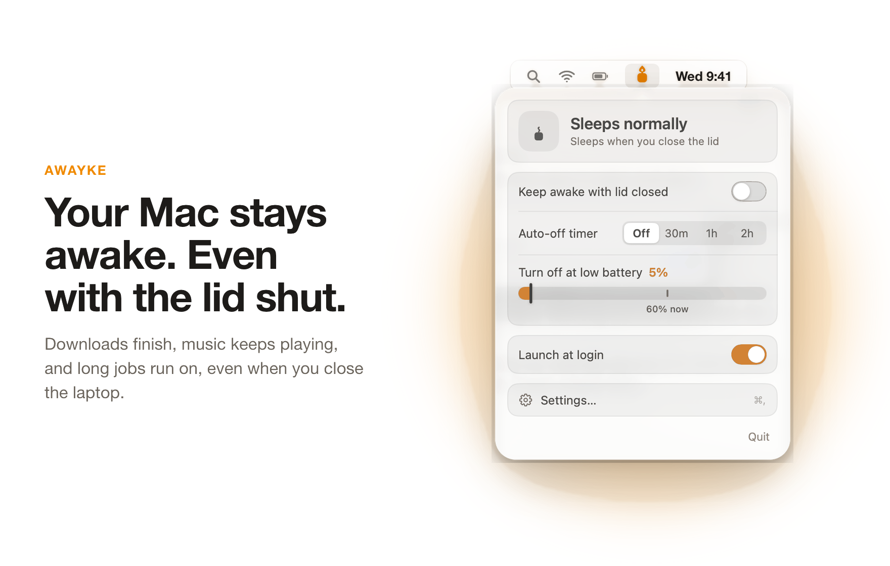
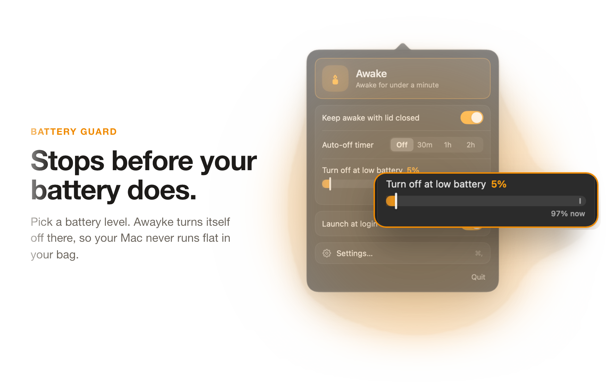
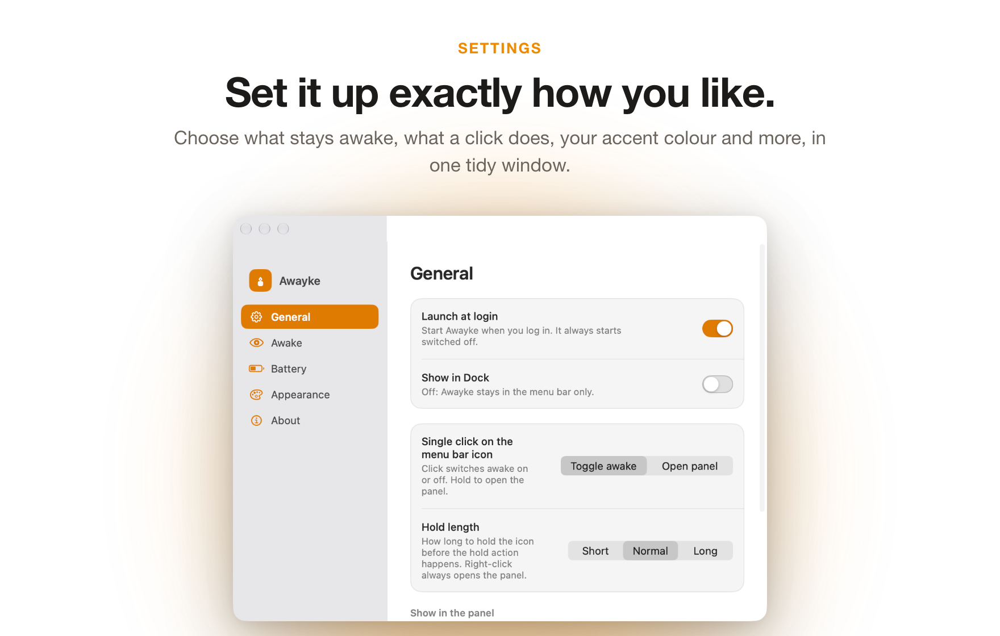

<div align="center">


<h1>Awayke</h1>

<p><b>Keep your MacBook awake with the lid closed. One click in the menu bar.</b></p>

<p>
  <a href="https://github.com/Solomon-69/Awayke/releases/latest"></a>
  
  <a href="LICENSE"></a>
  
</p>

<p>
  <a href="https://github.com/Solomon-69/Awayke/releases/latest"><b>Download</b></a>
  &nbsp;&middot;&nbsp;
  <a href="#install">Install</a>
  &nbsp;&middot;&nbsp;
  <a href="SECURITY.md">How it stays safe</a>
</p>

<br>

<picture>
  <source media="(prefers-color-scheme: dark)" srcset="docs/showcase/aw-1-dark.png">
  
</picture>

</div>

Closing a MacBook's lid puts it to sleep, even when it is busy. Apps built on `caffeinate`
cannot change that. Awayke switches the one macOS setting that can, and wraps it in safety
nets so you can stop thinking about it: a timer, a low-battery cutoff, and normal sleep coming
back on its own when you switch it off, quit or restart.

Good for overnight builds and downloads, sharing a hotspot from your bag, or keeping a server
or SSH session reachable with the lid shut.

## Contents

- [Features](#features)
- [Install](#install)
- [The one-time permission](#the-one-time-permission)
- [Usage and keyboard shortcuts](#usage-and-keyboard-shortcuts)
- [Settings](#settings)
- [Privacy](#privacy)
- [Requirements](#requirements)
- [FAQ and troubleshooting](#faq-and-troubleshooting)
- [Building from source](#building-from-source)
- [Uninstall](#uninstall)
- [Contributing](#contributing)
- [Credits](#credits)
- [Licence](#licence)

## Features

Awayke keeps your Mac awake, even with the lid closed, and always hands sleep back safely.

<picture>
  <source media="(prefers-color-scheme: dark)" srcset="docs/showcase/aw-2-dark.png">
  
</picture>

### Quiet with the lid closed

While Awayke is on and the lid is shut, it can make the Mac quieter and kinder to the battery. Everything goes back when you open the lid, switch Awayke off or quit (and at the next start if the app ever crashes).

- Turns the screen and keyboard light off, and wakes them when you open the lid.
- Mutes the sound, and unmutes it when the lid opens.
- Pauses the apps you choose (Slack, WhatsApp and Discord to start with), or every other app. Editors, terminals, browsers, AI apps, Apple apps and meeting or recording apps are never paused.
- Keeps terminals, editors and AI apps out of App Nap while it is on, if you want.
- Spots Chrome, Arc, Edge, Brave or Comet slowing hidden pages and offers to relaunch them so pages keep working.

### Optional low-battery cutoff

Off by default. Switch on **Turn off at low battery** and Awayke switches itself off at the level you choose (5 to 50 percent), so a forgotten MacBook never runs flat in your bag.

<picture>
  <source media="(prefers-color-scheme: dark)" srcset="docs/showcase/aw-3-dark.png">
  
</picture>

### Awake for as long as you need

Most of the time you only need your Mac awake for a while. Pick a timer and Awayke turns itself off when it runs out, with a live countdown in the panel.

- Off (stay awake until you say), 1 hour or 2 hours to start with.
- Add your own timer lengths in Settings, from 5 minutes to 30 days.
- **Add 30 min** while a timer runs, a notice 5 minutes before it ends, and the time left next to the menu bar icon if you want it.
- Normal sleep always comes back when the timer ends, when you switch it off, quit, restart, or if the app ever crashes.

<br>

<picture>
  <source media="(prefers-color-scheme: dark)" srcset="docs/showcase/aw-4-dark.png">
  
</picture>

### Set it up exactly how you like

One tidy Settings window holds everything, split into General, Awake, Lid, Battery, Appearance and About. About has Check for updates and the activity log.

- <b>Awake:</b> keep just the computer running, or keep the screen on too.
- <b>Clicks:</b> choose whether a click toggles awake or opens the panel, and how long a hold takes.
- <b>Appearance:</b> pick an accent colour and a coloured or monochrome menu bar icon.
- <b>General:</b> launch at login, and an optional Dock icon (off by default).


**Why it works with the lid shut:** apps built on `caffeinate` can keep a Mac awake with the lid
open, but closing the lid still sends it to sleep. Awayke switches the one macOS setting that can
stop that, using a small permission you approve once, and switches it straight back when you are done.
Awayke is tiny and native: no background helper, no kernel extension, no telemetry.


## Install

1. Download **Awayke.dmg** from the [latest release](https://github.com/Solomon-69/Awayke/releases/latest). A zip of the same app is there too.
2. Open it and drag **Awayke** into **Applications**.
3. Open Awayke from Applications. A small candle appears in your menu bar.
4. Click the candle to switch it on. The first time, Awayke asks for permission once (see below). Then close the lid.

**First run on an unsigned build.** If a release is not notarised by Apple, macOS asks before
opening it the first time:

- Right-click Awayke in Applications and choose **Open**, then confirm.
- If the dialog only offers "Done", open **System Settings > Privacy & Security**, scroll down and click **Open Anyway** next to Awayke.

You only need to do this once. Releases that are signed and notarised open straight away.

### Install with Homebrew (coming soon)

There is no Homebrew tap yet. When there is, installing will be one line:

```sh
brew install --cask awayke   # not available yet
```

## The one-time permission

Keeping a Mac awake with the lid closed means changing a protected system setting, which
normally needs an administrator password every time. A menu bar app cannot type a password for
you, so the first time you switch Awayke on it explains this and asks **once**, using the
normal macOS Touch ID or password prompt.

With that permission it installs one small rule that lets your user account run exactly two
commands without a password:

```
<you> ALL=(root) NOPASSWD: /usr/bin/pmset -a disablesleep 0, /usr/bin/pmset -a disablesleep 1, /usr/bin/pmset -a lowpowermode 0, /usr/bin/pmset -a lowpowermode 1
```

In plain terms: "turn lid-close sleep off" and "turn lid-close sleep back on". Nothing else.
macOS matches the command and its options exactly, so the rule cannot be stretched to run
anything else. It lives in one file, `/etc/sudoers.d/sleepless-disablesleep` (the name is kept
from the original Sleepless project so existing installs keep working), and the uninstaller
removes it.

The setting itself resets to normal sleep whenever the Mac restarts. The full security write-up
is in [SECURITY.md](SECURITY.md), and [docs/AUDIT.md](docs/AUDIT.md) shows how to check
everything yourself.

## Usage and keyboard shortcuts

| Action | How |
| --- | --- |
| Switch awake on or off | Click the candle in the menu bar |
| Open the panel | Hold the click for a moment, right-click, <kbd>Option</kbd>-click or <kbd>Control</kbd>-click the candle |
| Close the panel | Click anywhere else |
| Open Settings | <kbd>Command</kbd> <kbd>,</kbd> while the panel is open, or **Settings...** in the panel |
| Quit | <kbd>Command</kbd> <kbd>Q</kbd> while the panel is open. Normal sleep comes back right away. |

If you prefer, Settings can swap the two: a single click opens the panel instead of toggling.

## Settings

| Section | What you can change |
| --- | --- |
| **General** | Launch at login, what a single click on the icon does, how long a hold takes |
| **Awake** | Mac only or Mac and screen, the timer buttons shown in the panel (up to 30 days), time left in the menu bar, the 5-minute notice |
| **Lid** | What happens while the lid is closed: screen off, mute, pause chosen apps or every other app, App Nap, browser relaunch |
| **Battery** | Turn off at low battery (off by default) and its level |
| **Appearance** | Accent colour, coloured or monochrome menu bar icon |
| **About** | Version, credits, Check for updates, the activity log |

You can also hide the timer, the battery cutoff or the login switch from the panel to keep it short.

## Privacy

Nothing leaves your Mac. Awayke has no analytics and no accounts. The only network request is the one you make with **Check for updates** (Settings > About), which asks GitHub for the latest version and installs nothing. The activity log (`~/Library/Logs/Awayke/awayke.log`) is readable only by you.
Its settings are stored locally in macOS preferences.

## Requirements

- macOS 26 Tahoe or later.
- Tested on Apple silicon MacBooks.
- An administrator account for the one-time permission.

## FAQ and troubleshooting

<details>
<summary><b>Is it safe? Will my Mac overheat or drain the battery?</b></summary>

It is fine for light unattended work such as downloads, syncing or a hotspot. Heavy, sustained
work with the lid fully shut reduces airflow, so use judgement. The low-battery cutoff, the Low
Power Mode option and the timer all stop it before the battery runs flat.
</details>

<details>
<summary><b>I switched it on, closed the lid, and the Mac still slept.</b></summary>

Open the panel and check it says the Mac stays awake. Then run `pmset -g | grep SleepDisabled`
in Terminal: it should say `1` while Awayke is on. If it says `0`, the one-time permission may
be missing. Switch Awayke off and on again to be asked again, or reinstall with `./install.sh`.
</details>

<details>
<summary><b>Why does it need my password once? Other keep-awake apps don't.</b></summary>

Other apps cannot keep a Mac awake with the lid closed on battery. That needs the protected
`disablesleep` setting. Awayke asks once and installs a rule limited to exactly two commands.
See [The one-time permission](#the-one-time-permission).
</details>

<details>
<summary><b>Does it need a kernel extension or a background service?</b></summary>

No. It is one small native app with no kernel extension, no background helper and no Dock icon.
</details>

<details>
<summary><b>Why does Activity Monitor say "Sleepless"?</b></summary>

Awayke is a fork of Sleepless and keeps the original program name inside the app so existing
installs, settings and the permission rule carry over. The app you see is `/Applications/Awayke.app`.
</details>

<details>
<summary><b>Does it collect any data?</b></summary>

No. There are no analytics, and the only network request is Check for updates when you click it.
</details>

## Building from source

You only need Apple's Command Line Tools (`xcode-select --install`). There is no Xcode project.

```sh
git clone https://github.com/Solomon-69/Awayke.git
cd Awayke
./build.sh                 # builds ./build/Awayke.app (ad-hoc signed)
open build/Awayke.app
```

Or install it in one go:

```sh
./install.sh               # builds into /Applications, installs the permission rule and a login item
```

`install.sh` prints exactly what it will write before it asks you to continue. Apps you build
yourself are not blocked by Gatekeeper, so there is no "Open Anyway" step.

Releases are built by [`release.yml`](.github/workflows/release.yml) when a `v*` tag is pushed.
It attaches `Awayke.dmg`, a zip and checksums to a GitHub Release, with a signed build
provenance record. If the Apple signing secrets are set in the repository, the app is also
signed with a Developer ID and notarised. If they are not, those steps are skipped.

## Uninstall

From a clone of this repository:

```sh
./uninstall.sh
```

Or, if you only have the app:

```sh
/Applications/Awayke.app/Contents/Resources/uninstall.sh
```

It restores normal sleep, quits Awayke, removes the app and its login item, deletes the
permission rule (macOS asks for your password once, on purpose) and then checks that the rule
is really gone. Saved settings can be cleared with:

```sh
defaults delete com.aboudjem.Sleepless
```

## Contributing

Issues and pull requests are welcome. See [CONTRIBUTING.md](CONTRIBUTING.md) and the
[Code of Conduct](CODE_OF_CONDUCT.md). Awayke stays deliberately small. Security problems go
through [SECURITY.md](SECURITY.md), not public issues.

## Credits

Awayke is based on [**Sleepless**](https://github.com/Aboudjem/Sleepless) by **Adam Boudjemaa**,
released under the MIT licence. The keep-awake mechanism, the scoped permission rule, the safety
nets and the security documentation all come from his work. Thank you, Adam.

Redesigned by **Solomon**: the new panel and Settings window, the flame app icon, the candle menu bar icon and the name, custom
timer lengths, accent colours and a few extra options.

## Licence

[MIT](LICENSE). Copyright (c) 2026 Adam Boudjemaa (original Sleepless) and Copyright (c) 2026
Solomon (Awayke changes).
