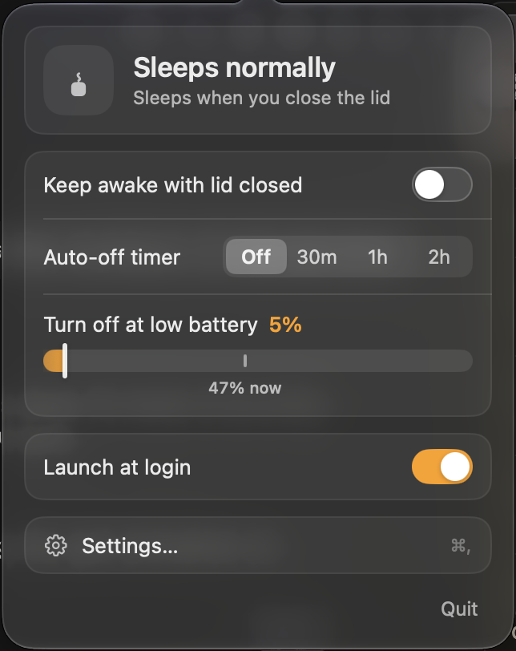

<p align="center">
  <picture>
    <source media="(prefers-color-scheme: dark)" srcset="assets/hero-dark.svg">
    <source media="(prefers-color-scheme: light)" srcset="assets/hero-light.svg">
    
  </picture>
</p>

<p align="center">
  <b>Keep your MacBook awake with the lid closed, on battery, with no external display.</b><br>
  <sub>One menu bar switch, with an auto-off timer and a low-battery cutoff so you never drain it flat.</sub>
</p>

<p align="center">
  <a href="LICENSE"></a>
  
  
</p>

## What it does

Closing a MacBook's lid puts it to sleep. Apps that use `caffeinate` (KeepingYouAwake and similar) cannot change that, by design. Awayke switches the one macOS setting that can, `pmset disablesleep`, and wraps it in safety nets so it is safe to forget about:

- **One switch.** Click the candle in the menu bar to turn it on or off (lit means awake, unlit means normal sleep). Hold the icon, or right-click it, to open the panel.
- **Auto-off timer.** Off, 30 minutes, 1 hour or 2 hours, with a live countdown. You can add your own timer lengths in Settings.
- **Low-battery cutoff.** On battery, Awayke switches itself off at a level you choose (5 to 50 percent).
- **Low Power Mode.** On battery, it can step aside when Low Power Mode is on.
- **Screen option.** Keep only the Mac running, or keep the screen on too.
- **Launch at login.** Optional. It always starts switched off.
- **Normal sleep comes back** when you switch it off, quit, restart, or if the app crashes.

Good for overnight builds and downloads, sharing a hotspot from your bag, or keeping a server or SSH session reachable with the lid shut.

<p align="center">
  
</p>

## Install

1. Download `Awayke-<version>.zip` from the [latest release](https://github.com/Solomon-69/Awayke/releases/latest) and double-click it to unzip.
2. Drag **Awayke.app** into your **Applications** folder.
3. The first time, **right-click Awayke.app and choose Open**, then confirm. Awayke is not notarized by Apple (that needs a paid developer account), so macOS asks before opening it.
   - On recent macOS versions the right-click dialog may only offer "Done". If so, open **System Settings > Privacy & Security**, scroll down and click **Open Anyway** next to Awayke, then confirm.
4. A small candle appears in your menu bar. Click it to switch Awayke on, then close the lid.

Awayke needs macOS 26 (Tahoe) or later and is tested on Apple Silicon.

## The one-time permission

Keeping a Mac awake with the lid closed means changing a protected system setting, which normally needs an administrator password every time. A menu bar app cannot type a password for you, so the first time you switch Awayke on it explains this and asks for permission **once**, using the normal macOS Touch ID or password prompt.

With that permission it installs one small rule that lets your user account run exactly two commands without a password:

```
<you> ALL=(root) NOPASSWD: /usr/bin/pmset -a disablesleep 0, /usr/bin/pmset -a disablesleep 1
```

In plain terms: "turn lid-close sleep off" and "turn lid-close sleep back on". Nothing else. The rule cannot be stretched to run other commands, because macOS matches the command and its options exactly. It lives in one file, `/etc/sudoers.d/sleepless-disablesleep` (the file name is kept from the original Sleepless project so existing installs keep working), and the uninstaller removes it.

The setting itself resets to normal sleep whenever the Mac restarts. The full security write-up is in [SECURITY.md](SECURITY.md), and [docs/AUDIT.md](docs/AUDIT.md) shows how to check everything yourself.

## Build from source

You only need Apple's Command Line Tools (`xcode-select --install`). There is no Xcode project.

```sh
git clone https://github.com/Solomon-69/Awayke.git
cd Awayke
./build.sh                 # builds ./build/Awayke.app (ad-hoc signed)
open build/Awayke.app
```

Or install it in one go:

```sh
./install.sh               # builds into /Applications, installs the permission rule and a login item
```

`install.sh` prints exactly what it is going to write before it asks you to continue. Apps you build yourself are not blocked by Gatekeeper, so there is no "Open Anyway" step.

## Uninstall

From a clone of this repository:

```sh
./uninstall.sh
```

Or, if you only have the app:

```sh
/Applications/Awayke.app/Contents/Resources/uninstall.sh
```

It restores normal sleep, quits Awayke, removes the app and its login item, deletes the permission rule (macOS asks for your password once, on purpose) and then checks that the rule is really gone. Saved settings can be cleared with:

```sh
defaults delete com.aboudjem.Sleepless
```

## FAQ

<details>
<summary><b>Is it safe? Will it overheat or drain the battery?</b></summary>

It is fine for light unattended work such as downloads, syncing or a hotspot. Heavy sustained work with the lid fully shut reduces airflow, so use judgement. The low-battery cutoff, Low Power Mode switch-off and the timer all stop it before the battery runs flat.
</details>

<details>
<summary><b>Does it need a kernel extension or a background service?</b></summary>

No. It is a small native app with no kernel extension, no background helper and no Dock icon. The only special access is the two-command rule described above.
</details>

<details>
<summary><b>Does it collect any data?</b></summary>

No. Awayke makes no network connections and has no analytics. Its settings are stored locally in macOS user defaults.
</details>

## Credits

Awayke is a fork of [**Sleepless**](https://github.com/Aboudjem/Sleepless) by **Adam Boudjemaa**, released under the MIT License. The keep-awake mechanism, the scoped permission rule, the safety nets and the security documentation all come from his work. Awayke adds a redesigned panel and Settings window, a new flame icon and name, and a few extra options. Thank you, Adam.

## Contributing

Issues and pull requests are welcome. See [CONTRIBUTING.md](CONTRIBUTING.md) and the [Code of Conduct](CODE_OF_CONDUCT.md). Awayke stays deliberately small.

## Licence

[MIT](LICENSE). Copyright (c) 2026 Adam Boudjemaa (original Sleepless) and Copyright (c) 2026 Solomon (Awayke changes).
